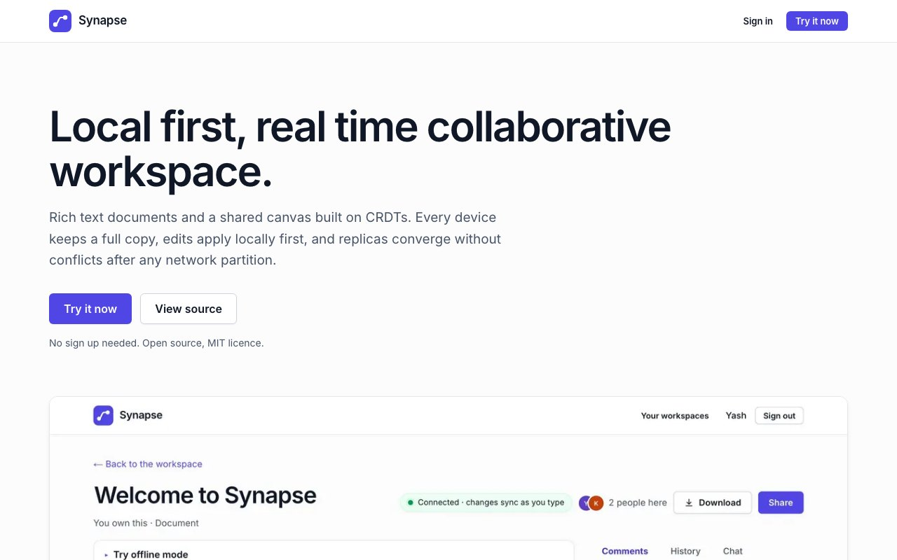
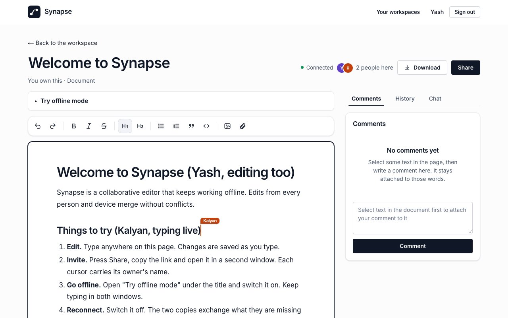
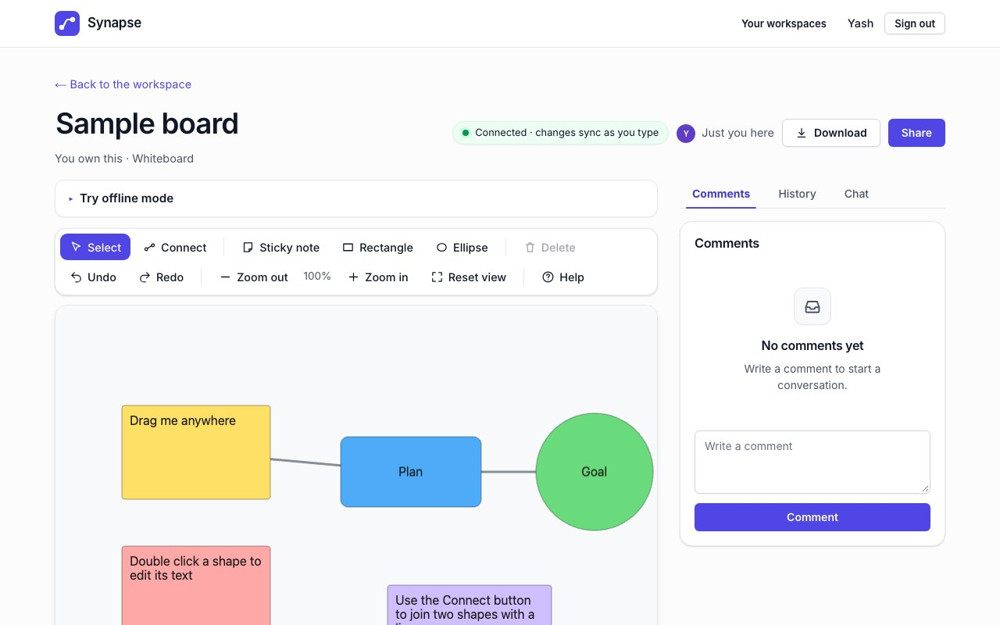
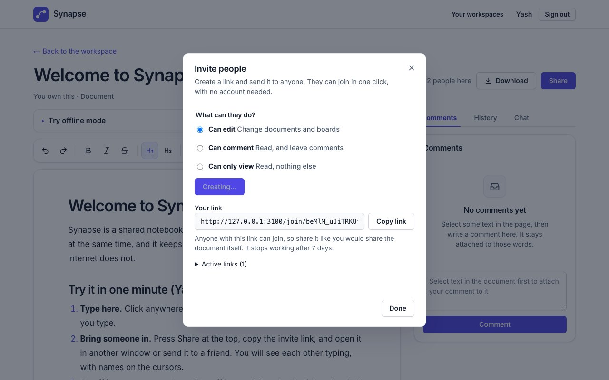
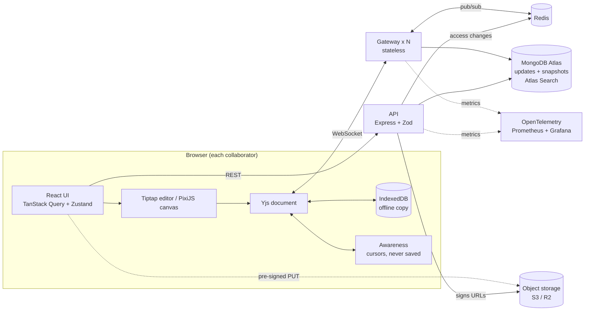

# Synapse

A local-first collaborative workspace: rich-text documents and a shared canvas
that keep working offline and merge cleanly when you reconnect.

Built by [Yashwanth Varma](https://github.com/yashwanthvarmakonduru). Live demo: <https://synapse-app-beta.vercel.app> (the server sleeps when idle on the free tier, so the first load can take up to a minute).

Write-up: [Why I used a CRDT and not OT for a collaborative editor](https://dev.to/yashwanthvarma/why-i-used-a-crdt-and-not-ot-for-a-collaborative-editor-54d5) (dev.to). The longer version is in [docs/blog](docs/blog/why-a-crdt-not-ot.md).



## Try it in one minute

You need Node 22+, MongoDB and Redis installed (`brew install redis` and
`brew tap mongodb/brew && brew install mongodb-community` on a Mac). Then:

```bash
./dev.sh
```

Open <http://localhost:3000> and press **Try it now**. No sign-up: you get a guest account, a Welcome document that
teaches the app, and a sample whiteboard in "My workspace". Press **Share**, copy the invite
link and open it in a second window to see two people editing live. Switch on **Try offline mode**,
type in both windows, switch it off, and watch everything merge.

Prefer containers? `cp .env.example .env`, set `JWT_SECRET`, then `docker compose up --build`
(MongoDB, Redis, an S3 compatible store, two gateways behind a load balancer, the API and the web app; run
and checked on 2 November 2026, see [`docs/DEPLOY.md`](docs/DEPLOY.md)). To put it on the internet with MongoDB Atlas, see the same guide.

| Document and toolbar | Whiteboard | Invite people with a link |
|---|---|---|
|  |  |  |

Guest accounts are temporary (a month); **Save your work** turns one into a real account. On a public server
you can turn guests off with `GUESTS_ENABLED=false` and clear old ones with
`cd server && npm run prune-guests -- --days 30` (add `--delete` to really remove them).

> **Read first:** [Why Synapse uses a CRDT and not OT](docs/blog/why-a-crdt-not-ot.md), the blog post behind the central design decision.

> **Status.** Deployed on the free tier and tested against real MongoDB, Redis, an S3 compatible bucket and real
> browsers. Auth is basic: no email verification or password reset.

## Architecture



### How an edit travels

1. You type. Tiptap turns the keystroke into a small Yjs update, and the screen paints before any network call.
2. `y-indexeddb` stores the update in the browser, so it survives a refresh or a dead connection.
3. The update goes over the WebSocket to the gateway holding your connection.
4. The gateway checks your role (viewers cannot write), applies the update to the room, and publishes it on Redis.
5. Every other gateway with that room open forwards it to its clients, where Yjs merges it deterministically.
6. The updates are appended to a log in MongoDB and periodically compacted into a snapshot.

### Built with the design system

The interface is built from the published component library [Meridian](https://github.com/yashwanthvarmakonduru/designSystem)
(`@yashwanthvarma74/react` and `@yashwanthvarma74/tokens`): buttons, fields, dialogs, tabs, menus, cards and
avatars all come from it, and Synapse's colours are the library's tokens. See [ADR 0019](docs/adr/0019-build-the-ui-with-the-design-system.md).

### Two consistency domains (the central design decision)

| Document content | Access control |
|---|---|
| Eventually consistent | Server-authoritative |
| Merged automatically by Yjs, editable offline | Checked on room join and on **every** write |
| Temporary differences between copies are fine | Never stored inside the shared document |
| | Revoking access takes effect immediately |

See [ADR 0002](docs/adr/0002-two-consistency-domains.md).

## Features

- **Block editor** (Tiptap): headings, lists, quotes, code, images and files, **slash commands** (type `/`), and **per-user undo** (it undoes only your edits, not other people's; tested in two real browsers).
- **Canvas** (PixiJS/WebGL): rectangles, ellipses, sticky notes, connectors, colours, pan and zoom, resize, per-user undo, live cursors, keyboard access for every action.
- **Live cursors and presence**, with joins announced to screen readers.
- **Offline editing** with merge on reconnect; reconnect uses exponential backoff with jitter.
- **Network simulator** ("Offline mode"): go offline, or add 200 ms to 3 s of delay, in one click.
- **Comments** anchored to text with Yjs relative positions, so they keep their place while others type.
- **Chat** for each document: live messages between the people on the page, saved and checked by the server on every message (viewers read, others write), with an unread count and screen-reader announcements ([ADR 0017](docs/adr/0017-chat.md)).
- **Version history**: named versions, preview, restore (current content is saved first).
- **Workspaces**: create as many as you like; the owner can delete one (everything in it goes, after typing its name to confirm; [ADR 0018](docs/adr/0018-workspace-deletion-and-first-landing.md)).
- **Sharing and roles**: owner, editor, commenter, viewer, enforced by the server. **Invite links** and **guest accounts** make it usable in seconds. Removing someone closes their open connection within about two seconds and clears their offline copy.
- **Search** across your workspaces with **Atlas Search** (typo tolerant, scoped to your workspaces), falling back to a MongoDB text index off Atlas.
- **Uploads**: images and files go straight from the browser to S3 / R2 (or any S3 compatible store) through pre-signed URLs ([ADR 0014](docs/adr/0014-uploads-with-presigned-urls.md)).
- **Observability**: one Grafana dashboard for sync latency, typing latency, reconnects, sockets, database writes, the Redis relay and the API; 12 alert rules including error-budget burn alerts for the 99.9% target; an uptime probe; structured JSON logs (Pino). See [`docs/OBSERVABILITY.md`](docs/OBSERVABILITY.md).
- **Accessibility**: WCAG 2.2 AA as the target, axe in real Chromium and WebKit, real keyboard testing; see [`docs/ACCESSIBILITY.md`](docs/ACCESSIBILITY.md) (**no screen reader was run**).

## Tech stack, and why

| Layer | Choice | Reason |
|---|---|---|
| App | Next.js 16, React 19, TypeScript | App shell and routing |
| Editor | Tiptap 3 (ProseMirror) + `y-tiptap` | Mature rich text with a first-class Yjs binding |
| Canvas | PixiJS 8 (WebGL) | Fast rendering of hundreds of shapes |
| CRDT | Yjs | Proven shared types, compact binary updates ([ADR 0001](docs/adr/0001-crdt-yjs-over-ot.md)) |
| Offline | `y-indexeddb` | Stores updates in the browser |
| Presence | Yjs awareness | Cursors are broadcast, never persisted |
| Client state | TanStack Query + Zustand | Query for server data (roles, comments), Zustand for UI-only state ([ADR 0015](docs/adr/0015-client-state-query-and-zustand.md)) |
| Realtime | Node + `ws` + `y-protocols`, written by hand | The sync protocol is the learning ([ADR 0003](docs/adr/0003-custom-ws-gateway.md)) |
| Fan-out | Redis pub/sub | Any gateway can serve any room ([ADR 0006](docs/adr/0006-stateless-gateways-redis.md)) |
| API | Express 5 + Zod | Every request body validated |
| Database | MongoDB Atlas + Atlas Search | Binary updates keyed by document, plus search ([ADR 0005](docs/adr/0005-mongodb-storage.md), [0013](docs/adr/0013-atlas-search.md)) |
| Storage | S3 / Cloudflare R2 (S3Mock locally) | Uploads straight from the browser ([ADR 0014](docs/adr/0014-uploads-with-presigned-urls.md)) |
| Auth | scrypt passwords, signed JWTs (`jose`), guests, invite links | ([ADR 0007](docs/adr/0007-authentication.md), [0012](docs/adr/0012-guest-accounts-and-invite-links.md)) |
| Observability | OpenTelemetry (metrics) + Prometheus + Grafana, Pino logs | ([ADR 0011](docs/adr/0011-observability.md)) |
| Testing | Vitest + fast-check, Playwright, k6, `promtool` | Property-based convergence, multi-browser end-to-end, WebSocket load, alert rules |

Architecture decision records are in [`docs/adr/`](docs/adr/) (including failure handling, observability, uploads, chat and workspace deletion).

## Run it

You need Node 22+, MongoDB and Redis. On macOS with Homebrew:

```bash
brew install redis
brew tap mongodb/brew && brew trust mongodb/brew && brew install mongodb-community
```

Start the data stores (data stays in `.infra/`; nothing runs at login):

```bash
mkdir -p .infra/redis .infra/mongo
redis-server --port 6379 --dir .infra/redis --save "" --appendonly no &
mongod --dbpath .infra/mongo --port 27017 --bind_ip 127.0.0.1 &
```

Start the server (gateway on :4000, API on :4001) and the web app (:3000):

```bash
cd server && npm install && npm run dev
cd web    && npm install && npm run dev
```

Optional: the monitoring dashboard (needs `brew install prometheus grafana` once):

```bash
observability/start.sh        # Prometheus :9090, Grafana :3030 (dashboard "Synapse"; stop with observability/stop.sh)
```

Open <http://localhost:3000/login> and create an account. To be signed in as
two people at once, use `localhost:3000` for one and `127.0.0.1:3000` for the
other: each address keeps its own login. (Accounts live only in your local
MongoDB; the demo scripts in `server/bench/` take an account from the
`DEMO_EMAIL` and `DEMO_PASSWORD` environment variables.)

Settings are environment variables (all optional in development); `server/.env` is read automatically
if it exists (it is git-ignored, and `server/.env.example` is the template). The common ones: `MONGO_URL`
(a `mongodb+srv://` Atlas address turns Atlas Search on), `MONGO_DB`, `REDIS_URL` (set by `npm run dev`),
`JWT_SECRET` (**required** when `NODE_ENV=production`; 32+ characters), `WEB_ORIGIN`, `S3_*` (uploads),
`GATEWAY_PORT`, `API_PORT`, `SERVICE=gateway|api|both`, `METRICS_PORT`
(default 9464, `0` turns metrics off), `LOG_LEVEL`. The full table, with what each one does, is in
[`docs/DEPLOY.md`](docs/DEPLOY.md).

## Tests and benchmarks

```bash
cd server && npm test        # 127 tests: sync, roles, revocation, storage, compaction, self-healing, metrics, guests, uploads, chat, workspace deletion, uptime probe
cd web    && npm test        # 202 tests: canvas model, colour contrast, keyboard and ARIA, sync client, slash menu, uploads, chat
cd web    && npm run lint    # ESLint with Next.js and React 19 rules
cd server && npm run lint    # ESLint with typescript-eslint, including the unawaited promise checks
cd server && npm run test:fault  # kills and restarts real Redis and MongoDB, crashes gateways (needs mongod and redis-server on the PATH)
cd web    && npm run typecheck  # generates Next.js types, then runs tsc
cd e2e    && npm run test:local   # 53 end-to-end tests per browser, in real Chromium and WebKit (starts its own app and database)
cd e2e    && npm test             # adds Firefox: 159 passed and 9 skipped across the three browsers in CI (Firefox does not start on the development Mac)
cd observability && promtool test rules tests/slo_test.yml   # the availability alerts, with synthetic traffic
cd load/k6 && npm install && npm run build && k6 run -e EDITORS=50 editors.js   # k6 load test
cd server && npm run bench:load   # also: bench:propagation, bench:partition, bench:convergence
```

The server tests run against real MongoDB and Redis, so start them first. The end-to-end tests need
MongoDB on :27017; `E2E_S3=1` also runs the upload test against a local S3 compatible store (S3Mock, or MinIO if you already have it).

**Fault injection** (`cd server && npm run test:fault`, about 90 seconds) breaks Redis,
MongoDB, gateways and the WebSocket input while people are editing, using private
copies of the databases so your own data is untouched. It found a crash from
malformed input, edits lost during a database outage, and a relay that never
repaired itself after a long Redis outage; all fixed and re-tested. Results,
including what was NOT tested: [`docs/FAULT-INJECTION.md`](docs/FAULT-INJECTION.md).

Headline results (one laptop, loopback network, so these show the server's own
cost, not real-world latency; method and limits in [`docs/BENCHMARKS.md`](docs/BENCHMARKS.md)):

| Measure | Target | Result |
|---|---|---|
| Remote update propagation, p95 | < 250 ms | 0.8 ms (1.3 ms across two gateways) |
| Convergence after a long partition | < 2 s | 13 to 58 ms (simulated); **113 to 421 ms in real browsers** (Playwright) |
| Randomized convergence | 100% | 10,000 of 10,000 runs |
| Editors in one room | 50+ | 200, no lost messages, p95 6.5 ms (Node harness); k6 at 50 editors: p95 7 ms |
| Keystroke-to-paint, p95 | < 50 ms | 16.6 to 17.4 ms |
| Canvas with 500+ objects | 60 FPS | about 120 FPS (120 Hz display) |

**One result that did not meet the target, with the reason:** k6 at 100 editors measured p95 283 ms,
but k6 itself was using about 12 cores while the gateway used 17% of one; the delay is the load generator
([`docs/BENCHMARKS.md`](docs/BENCHMARKS.md) section 4b).

## Repository layout

```
server/src     gateway (gateway.ts, room.ts), storage (store.ts, mongoStore.ts), message bus (bus.ts, redisBus.ts),
               REST API (api.ts, with one file per feature in routes/), auth, uploads, chat, logging
server/test    integration and property tests
server/fault   fault-injection tests (private Redis and MongoDB, killed on purpose)
server/bench   benchmark scripts; results in bench/results/
server/ops     the outside-in uptime probe
web/src/app          pages (Next.js routes)
web/src/components   by feature: layout, home, auth, workspace, document, board, ui
web/src/lib          collab (sync client), board (canvas model and renderer), chat, editor (slash menu, uploads),
                     export (PDF, Word, text, images), server data (queries.ts), UI state (uiStore.ts)
e2e            Playwright end-to-end tests: collaboration, offline merge, roles, editor, versions, downloads, accessibility
load/k6        k6 load test over real WebSockets with the Yjs protocol
deploy         Caddy config for the Docker Compose gateways (docker-compose.yml and the Dockerfiles are at the top and in server/, web/)
docs           blog post, deployment guide, benchmarks, fault-injection, accessibility and observability reports, ADRs
observability  Prometheus config, alert rules and their tests, Grafana provisioning and the generated dashboard
lab            Yjs experiments you can run: two documents merging in a terminal, and the demos behind the blog post
```

## License

[MIT](LICENSE)

## Deploying

[`docs/DEPLOY.md`](docs/DEPLOY.md) has a free route (Vercel + Render + Atlas, no card) and the full settings table.
